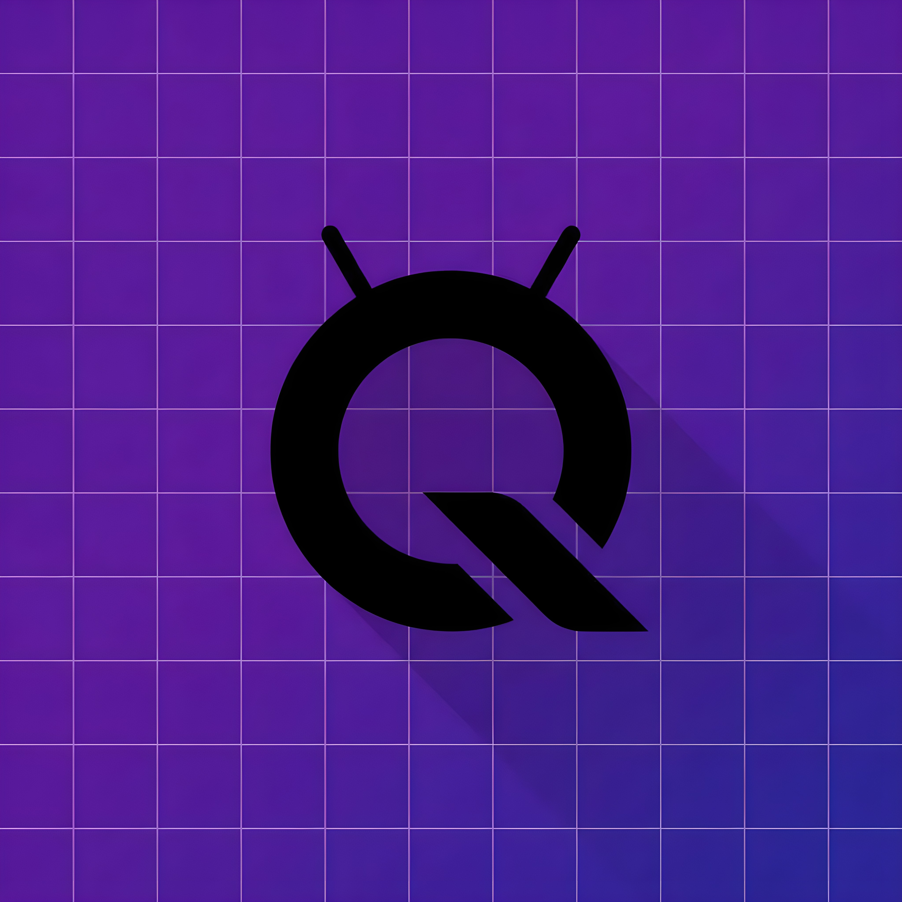

<div align="center">
  
  <h1 style="margin: 0; padding: 0; font-size: 64px;">QuDroid</h1>
</div>

# QuDroid

Emulate Android 1.0–17 firmware—including HTC Sense, TouchWiz, MIUI, and AOSP—on a modern phone. A fork of [AEmulator Plus](https://github.com/somerandomusernam2/AEmulator-Plus), which is a fork of [AEmulator](https://github.com/uxazu/AEmulator), featuring new features, improvements, and UI enhancements.

[English](README.md) · [Русский](docs/i18n/README.ru.md) · [Українська](docs/i18n/README.uk.md) · [Deutsch](docs/i18n/README.de.md) · [Français](docs/i18n/README.fr.md) · [Español](docs/i18n/README.es.md) · [Português](docs/i18n/README.pt-BR.md) · [Italiano](docs/i18n/README.it.md) · [Polski](docs/i18n/README.pl.md) · [Türkçe](docs/i18n/README.tr.md) · [العربية](docs/i18n/README.ar.md) · [فارسی](docs/i18n/README.fa.md) · [हिन्दी](docs/i18n/README.hi.md) · [Indonesia](docs/i18n/README.id.md) · [Tiếng Việt](docs/i18n/README.vi.md) · [简体中文](docs/i18n/README.zh-CN.md) · [日本語](docs/i18n/README.ja.md) · [한국어](docs/i18n/README.ko.md)

---

QuDroid boots real Android system images directly from existing firmware files. It translates ARM binaries with a patched QEMU, emulates the kernel binder, renders graphics via your phone's GPU, and outputs audio through Android's audio stack—all inside a standard app.

## Features

- **Broad firmware support**: Import Android-x86 `.iso`, CWM/TWRP ZIP, Samsung Odin `.tar.md5`, Google factory `.tgz`, `system.img`, OTA `system.new.dat.br`, Motorola `.sbf`, sparse images, EDL images, Spreadtrum `.pac`, HTC `.nbh`, HTC `RUU.exe`, and more.
- **Vendor skins**: Run compatible vendor interfaces out of the box, including HTC Sense, Samsung TouchWiz, MIUI, and AOSP.
- **Hardware & system integration**: GPU acceleration via GL bridge, audio output, touch and multitouch input, networking with a modern TLS proxy, and a shared storage folder for APKs, music, and photos.
- **VM screen themes & editor**: Customize navigation bar and screen frame themes—Original, Sunset, Gingerbread 2.x, Honeycomb 3.x, Holo 4.x, Lollipop 5.x, or custom themes—with a live editor (key shapes and size, bar/key/pressed/frame colors, glow and halo, floating or flat bar, frame image, and rounded corners). Export and share themes as `.aetheme` files under **Settings > Appearance > VM screen theme**.
- **Library organization**: Press and hold to reorder ROMs (list and grid views), or group them into collapsible folders by dragging onto a folder or selecting **Move to folder** from the `⋮` menu.
- **Interface & licensing**: Material 3 Expressive UI across 19 languages, released under the GPL-3.0 license.

## Quick Start

1. Download and install the APK from [Releases](https://github.com/Zyoo-0X/QuDroid/releases).
2. Open QuDroid, tap **Add firmware**, and select your firmware file. Importing may take a few minutes.
3. Tap **Start**. The first boot takes longer while the system optimizes apps.
4. Use the `⋮` menu for volume, power controls, and logs, and the settings icon for app preferences and language selection.

## Requirements

- Android 8.0 or later on a 64-bit ARM device (`arm64-v8a`)
- 1–3 GB of free storage per firmware image
- Snapdragon SoC recommended due to known issues with Mali GPUs

## Build from Source

Release builds are tested with JDK 21 and Android SDK 36. See the [build instructions](docs/build-source.md) for native toolchain setup and signing details.

```bash
git clone [https://github.com/Zyoo-0X/QuDroid.git](https://github.com/Zyoo-0X/QuDroid.git)
cd QuDroid
./gradlew copyReleaseApks
